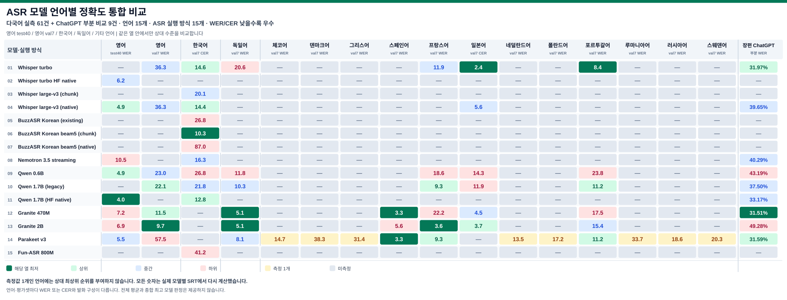

# LzASR — Automatic Speech Recognition (ASR)

**Public Baseline 0.0.0** · 로컬 자동 음성 인식, Speech-to-Text(STT), SRT 자막 생성 도구입니다.

ASR은 음성을 텍스트로 인식하는 기술이며, SRT는 인식 결과에 자막 시간 정보를 결합한 파일 형식입니다. 전사 정확도와 자막 타임스탬프 정확도는 구분해 평가합니다.

## ASR 모델 성능 통합 비교

**전체 모델·언어 실측 61건:** 아래의 가로 확장형 표와 [원본 크기 SVG](doc/ASR_Integrated_Comparison.svg)를 참조하십시오. 미측정은 —로 표시합니다.

[GitHub Wiki — 상세 모델 비교·용어집](https://github.com/spark00000/LzASR/wiki/ASR-Model-Comparison) · [재현 조건과 공식 출처](doc/ASR_Model_Comparison_20261106.md)

### 1. 영어 (WER)

Google FLEURS en_us **test 분할 40개 독립 발화**, 총 **424.02초 / 정답 897단어**. 모든 결과에 같은 텍스트 정규화를 적용했습니다. **WER가 낮을수록 좋습니다.**

| 영어 모델 및 실행 방식 | WER ↓ | 오류 단어 | 관측 시간* |
|---|---:|---:|---:|
| Qwen3-ASR 1.7B — HF native | **4.01%** | 36 / 897 | 20.92초 |
| Qwen3-ASR 0.6B | 4.91% | 44 / 897 | 22.53초 |
| Whisper large-v3 — HF native | 4.91% | 44 / 897 | 39.50초 |
| Parakeet TDT 0.6B v3 | 5.46% | 49 / 897 | 8.91초 |
| Whisper large-v3-turbo — HF native | 6.24% | 56 / 897 | 12.16초 |
| Granite Speech 5.0 2B | 6.91% | 62 / 897 | 54.75초 |
| Granite Speech 5.0 470M TurboCTC | 7.25% | 65 / 897 | **6.26초** |
| Nemotron 3.5 Streaming 0.6B | 10.48% | 94 / 897 | 13.30초 |

* 모델 로딩을 포함한 1회 관측값입니다. 엔진·디코딩·배치 조건이 완전히 같지 않아 통제된 속도 순위가 아닙니다. Whisper turbo의 영어 수치는 HF 네이티브 실행으로 측정했으며, 별도 Windows 실행기 결과와 구분합니다.

### 2. 한국어 (CER)

FLEURS ko_kr **validation 7개 연결 발화 / 115.48초**의 CER(문자 오류율)입니다. 영어 test 40발화와는 서로 다른 평가 표본입니다.

| 모델 및 실행 방식 | 한국어 CER ↓ |
|---|---:|
| BuzzASR Korean, beam=5 청크 | **10.25%** |
| Qwen3-ASR 1.7B HF 네이티브 | 12.76% |
| Whisper large-v3 네이티브 | 14.44% |
| Whisper large-v3-turbo 기존 실행기 | 14.64% |
| Nemotron 3.5 Streaming 0.6B | 16.32% |
| Qwen3-ASR 1.7B 기존 실행기 | 21.76% |
| Qwen3-ASR 0.6B | 26.78% |

### 3. 독일어 (WER)

FLEURS de_de **validation 7개 연결 발화**의 WER(단어 오류율)입니다. **이번 영어 test 40발화와 직접 비교하거나 점수를 합산하지 않습니다.**

| 모델 및 실행 방식 | 독일어 WER ↓ |
|---|---:|
| Granite Speech 5.0 2B | **5.15%** |
| Granite Speech 5.0 470M TurboCTC | **5.15%** |
| Parakeet TDT 0.6B v3 | 8.09% |
| Qwen3-ASR 1.7B 기존 실행기 | 10.29% |
| Qwen3-ASR 0.6B | 11.76% |
| Whisper large-v3-turbo 기존 실행기 | 20.59% |

**평가 기준:** 표의 정규화·인식 방식은 해당 평가 실행의 설정을 따릅니다. 같은 모델이라도 네이티브 및 기존 실행기를 혼용해 동일한 디코더 결과라고 주장하지 않습니다. WER와 CER, 언어별 서로 다른 평가셋의 결과를 더하거나 평균하지 않습니다.

**평가 한계:** 영어는 공식 test 전체 647발화 중 40발화 부분표본이며, 한국어·독일어는 각각 validation 7발화 표본입니다. Qwen 1.7B가 관측 최저 WER이지만 Whisper large-v3와의 대응표본 재추출 95% 구간은 0을 포함하므로 전역 우수성을 확정할 수 없습니다. 기준 발화의 타임스탬프로 결과 SRT를 생성했으므로 **모델 자체의 자막 시간정렬 성능은 검증하지 않았습니다.**

## 전체 언어·모델 통합 실측표 (61건)

공식 FLEURS 기준 SRT와 이미 생성한 모델별 SRT를 재채점했습니다. 언어는 영어 → 한국어 → 독일어 → 기타 언어 순서입니다. 영어 test40은 독립 40발화, 나머지 val7은 연결한 7발화입니다. **서로 다른 언어 또는 WER/CER를 평균하지 마십시오.**

기호 — 는 실제 결과가 없는 미측정을 뜻하며 **지원 불가능 또는 100% 오류가 아닙니다.** 30개 언어의 기준 샘플 중 실제 모델 인식 출력을 가진 언어는 15개입니다.

| ASR 모델·실행 방식 | 영어 (test40 WER) ↓ | 영어 (val7 WER) ↓ | 한국어 (val7 CER) ↓ | 독일어 (val7 WER) ↓ | 체코어 (val7 WER) ↓ | 덴마크어 (val7 WER) ↓ | 그리스어 (val7 WER) ↓ | 스페인어 (val7 WER) ↓ | 프랑스어 (val7 WER) ↓ | 일본어 (val7 CER) ↓ | 네덜란드어 (val7 WER) ↓ | 폴란드어 (val7 WER) ↓ | 포르투갈어 (val7 WER) ↓ | 루마니아어 (val7 WER) ↓ | 러시아어 (val7 WER) ↓ | 스웨덴어 (val7 WER) ↓ | 장편 ChatGPT(부분 WER) ↓ |
| :--- | :---: | :---: | :---: | :---: | :---: | :---: | :---: | :---: | :---: | :---: | :---: | :---: | :---: | :---: | :---: | :---: | :---: |
| Whisper turbo | — | 36.28% | 14.64% | 20.59% | — | — | — | — | 11.86% | **2.39%** | — | — | **8.39%** | — | — | — | 31.97% |
| Whisper turbo HF native | 6.24% | — | — | — | — | — | — | — | — | — | — | — | — | — | — | — | — |
| Whisper large-v3 (chunk) | — | — | 20.08% | — | — | — | — | — | — | — | — | — | — | — | — | — | — |
| Whisper large-v3 (native) | 4.91% | 36.28% | 14.44% | — | — | — | — | — | — | 5.57% | — | — | — | — | — | — | 39.65% |
| BuzzASR Korean (existing) | — | — | 26.78% | — | — | — | — | — | — | — | — | — | — | — | — | — | — |
| BuzzASR Korean beam5 (chunk) | — | — | **10.25%** | — | — | — | — | — | — | — | — | — | — | — | — | — | — |
| BuzzASR Korean beam5 (native) | — | — | 87.03% | — | — | — | — | — | — | — | — | — | — | — | — | — | — |
| Nemotron 3.5 streaming | 10.48% | — | 16.32% | — | — | — | — | — | — | — | — | — | — | — | — | — | 40.29% |
| Qwen 0.6B | 4.91% | 23.01% | 26.78% | 11.76% | — | — | — | — | 18.56% | 14.32% | — | — | 23.78% | — | — | — | 43.19% |
| Qwen 1.7B (legacy) | — | 22.12% | 21.76% | 10.29% | — | — | — | — | 9.28% | 11.94% | — | — | 11.19% | — | — | — | 37.50% |
| Qwen 1.7B (HF native) | **4.01%** | — | 12.76% | — | — | — | — | — | — | — | — | — | — | — | — | — | 33.17% |
| Granite 470M | 7.25% | 11.50% | — | **5.15%** | — | — | — | **3.33%** | 22.16% | 4.51% | — | — | 17.48% | — | — | — | 31.51% |
| Granite 2B | 6.91% | **9.73%** | — | **5.15%** | — | — | — | 5.56% | **3.61%** | 3.71% | — | — | 15.38% | — | — | — | 49.28% |
| Parakeet v3 | 5.46% | 57.52% | — | 8.09% | 14.66% | 38.26% | 31.40% | **3.33%** | 9.28% | — | 13.51% | 17.24% | 11.19% | 33.70% | 18.64% | 20.27% | 31.59% |
| Fun-ASR 800M | — | — | 41.21% | — | — | — | — | — | — | — | — | — | — | — | — | — | — |

**기존 다국어 61건 + ChatGPT reference 부분표본 장편 비교 9건(00:37:45까지) · ASR 실행 방식 15종.**

### 장편 ChatGPT reference — 부분 전사·상대 WER (PARTIAL)

**전체 영상 기준 평가 상태: FAIL/PARTIAL · 최종 로컬 모델 미선정.** 전체 02:37:54 중 ChatGPT가 실제 받아쓴 결과는 첫 00:37:45까지만 확보되었습니다. 아래 9개 WER는 **부분표본의 진단값**이며 최종 선정에 적용하지 않습니다. 전체 ChatGPT 결과를 상대 기준 **100**으로 삼아 전체 WER 최저 모델을 선정하도록 정의했지만 아직 전체 N/S/D/I를 산출할 수 없습니다. 일부 로컬 SRT의 마지막 cue도 약 02:28~02:30에서 끝나므로 해당 영상의 후반부 음성·무음 커버리지 확인이 선행되어야 합니다. [전체 평가 게이트 및 9개 후보별 SRT 범위](doc/ASR_Model_Comparison_20261106.md)를 참고하십시오.

- **참조 기준:** ChatGPT Windows 앱의 실제 **음성 입력(받아쓰기)** 기능에 영상에서 추출한 음성을 전달하여 반환받은 텍스트만 사용했습니다. FFmpeg의 오디오 추출·형식 변환만 이용했고, Whisper·Qwen 등 **어떤 로컬 ASR 모델도 ChatGPT reference 제작에 사용하지 않았습니다.**
- **완료 범위:** 전체 오디오 약 02:37:54 중 **00:00:00~00:37:45**, ChatGPT 전사 5개 구간, 영어 NFKC 정규화 후 **2,656단어**. 실제 참고 텍스트는 공개 저장소가 아닌 로컬 비공개 테스트 디렉터리에 보존했습니다.
- **미완료 범위:** **00:37:45~02:37:54**. 이후 ChatGPT 음성 입력이 빈 결과를 반복 반환했고, 이전에 성공했던 26초 양성 대조 입력도 빈 결과를 반환하여 추가 전사를 정답으로 간주할 수 없습니다. 서비스 측 정확한 원인은 확인되지 않았습니다. 미완성 구간을 로컬 모델의 전사로 대체하지 않았습니다.
- **오디오·타임스탬프 한계:** 기존 MP3는 영상에서 추출한 **전체 오디오 트랙**이며 음악과 효과음이 섞여 있습니다. 별도 보컬·대사 분리는 완료되지 않았습니다. 5개 SRT cue는 입력 조각의 시간 경계일 뿐, 자막 한 문장별 정밀 타임스탬프 검증이 아닙니다.
- **측정 방식:** 동일한 5개 시간 창에서 로컬 모델 SRT cue의 중앙 시점으로 대응시키고, NFKC·대소문자 통일·문장부호 및 기호 제외 후 각 구간의 단어 레벤슈타인 편집거리를 합산했습니다. 분모는 ChatGPT 부분 전사의 2,656단어입니다. WER는 **ChatGPT 부분 전사에 대한 상대 오류율**로, 전체 길이의 WER나 절대 정답률을 뜻하지 않습니다.

| 로컬 모델 (기존 출력) | ChatGPT reference 부분 WER ↓ | 편집 오류 / 2,656단어 |
|---|---:|---:|
| Granite Speech 5.0 470M TurboCTC | **31.51%** | 837 |
| Parakeet TDT 0.6B v3 | 31.59% | 839 |
| Whisper large-v3-turbo 기존 실행기 | 31.97% | 849 |
| Qwen3-ASR 1.7B HF 네이티브 | 33.17% | 881 |
| Qwen3-ASR 1.7B 기존 실행기 | 37.50% | 996 |
| Whisper large-v3 네이티브 | 39.65% | 1,053 |
| Nemotron 3.5 Streaming 0.6B | 40.29% | 1,070 |
| Qwen3-ASR 0.6B | 43.19% | 1,147 |
| Granite Speech 5.0 2B | 49.28% | 1,309 |

**판정:** 장편 전체에 대한 ChatGPT reference 생성과 WER 비교는 **FAIL/PARTIAL**입니다. 로컬 Qwen으로 만든 기존 자동 기준은 ChatGPT reference가 아니므로 현재 점수에서 제외했습니다. 과거 지표와 기준은 Git 이력으로 복원할 수 있으며 새 표의 수치와 비교하지 마십시오. 원음의 사람이 확인한 정답 전사가 아니므로 ChatGPT 부분 전사에도 누락이나 오인식이 있을 수 있습니다.

## 자동 언어 감지 및 모델 선택

기본 엔진은 **auto**입니다. FFmpeg로 오디오를 메모리에 추출하면서 **12초 구간의 RMS(음량)와 FFT 음성 주파수대(120~3,800Hz) 에너지**를 계산합니다. 서로 45초 이상 떨어진 높은 음량 구간 최대 5개에 Whisper large-v3의 언어 감지(LID)를 적용하고 **다수결로 영상 전체의 언어 하나만 선택**합니다. 영상 도중 언어가 바뀌어도 모델을 전환하지 않습니다. 음악·효과음이 큰 경우 감지가 틀릴 수 있습니다. 여러 언어가 나오면 표가 많은 언어 하나를 사용하고, 동률이면 선택된 고음량 구간의 RMS 합계가 큰 언어를 선택하며 경고합니다.

**Whisper large-v3가 식별하는 공식 100개 언어 코드를 모두 처리할 수 있습니다.** 다음 30개 FLEURS 언어·지역 코드 중 실제 측정된 15개는 기존 소규모 벤치마크에서 오류율이 가장 낮았던 실행 방식을 우선 선택하고, **나머지 15개는 Whisper turbo를 대체 경로로 사용**합니다. 나머지 70개 Whisper 언어 코드에도 같은 대체 경로가 적용됩니다.

| 언어 | 코드 | 자동 선택 모델 | 기존 근거 |
|---|---|---|---|
| 영어 | en | Qwen3-ASR 1.7B HF | test40 WER 4.01% |
| 한국어 | ko | BuzzASR Korean beam5 | val7 CER 10.25% |
| 독일어 | de | Granite Speech 470M | val7 WER 5.15% |
| 일본어 | ja | **Whisper large-v3-turbo** | val7 CER **2.39%** |
| 체코어 | cs | Parakeet TDT v3 | val7 WER 14.66% |
| 덴마크어 | da | Parakeet TDT v3 | val7 WER 38.26% |
| 그리스어 | el | Parakeet TDT v3 | val7 WER 31.40% |
| 스페인어 | es | Granite Speech 470M | val7 WER 3.33% |
| 프랑스어 | fr | Granite Speech 2B | val7 WER 3.61% |
| 네덜란드어 | nl | Parakeet TDT v3 | val7 WER 13.51% |
| 폴란드어 | pl | Parakeet TDT v3 | val7 WER 17.24% |
| 포르투갈어 | pt | Whisper large-v3-turbo | val7 WER 8.39% |
| 루마니아어 | ro | Parakeet TDT v3 | val7 WER 33.70% |
| 러시아어 | ru | Parakeet TDT v3 | val7 WER 18.64% |
| 스웨덴어 | sv | Parakeet TDT v3 | val7 WER 20.27% |
| 아랍어 | ar | Whisper large-v3-turbo | 미측정 |
| 중국어(표준) | zh | Whisper large-v3-turbo | 미측정 |
| 광둥어 | yue | Whisper large-v3-turbo | 미측정 |
| 페르시아어 | fa | Whisper large-v3-turbo | 미측정 |
| 필리핀어 | tl | Whisper large-v3-turbo | 미측정 |
| 핀란드어 | fi | Whisper large-v3-turbo | 미측정 |
| 힌디어 | hi | Whisper large-v3-turbo | 미측정 |
| 헝가리어 | hu | Whisper large-v3-turbo | 미측정 |
| 인도네시아어 | id | Whisper large-v3-turbo | 미측정 |
| 이탈리아어 | it | Whisper large-v3-turbo | 미측정 |
| 마케도니아어 | mk | Whisper large-v3-turbo | 미측정 |
| 말레이어 | ms | Whisper large-v3-turbo | 미측정 |
| 태국어 | th | Whisper large-v3-turbo | 미측정 |
| 튀르키예어 | tr | Whisper large-v3-turbo | 미측정 |
| 베트남어 | vi | Whisper large-v3-turbo | 미측정 |

**주의:** 기존 성능은 짧은 공식 평가 부분표본에서 얻은 잠정적인 모델 선택 근거이며 언어 전체에서 최고라는 보장은 없습니다. 음악이 사람 음성보다 크면 LID가 틀릴 수 있습니다. 모델 가중치가 없는 경우에는 설치된 Whisper로 전환하며 다운로드하지 않습니다. 비-Whisper 선택 모델의 자막 시간은 약 12초 오디오 구간에 기반한 근사이며 단어 단위 강제 정렬과 다릅니다.

~~~bat
out\asr.bat "video.mp4" --asr-only
out\asr.bat "video.mp4" --probe-only
out\asr.bat "video.mp4" --source-language ja --asr-only
out\asr.bat --list-routing
out\asr_gui.bat
~~~

이전 수동 엔진 선택은 --engine whisper, --engine qwen17, --engine qwen06으로 유지합니다. 자동 선택은 언어별 모델 이름이 포함된 SRT를 입력 영상 옆에 생성하며 기존 자막은 덮어쓰지 않습니다. --probe-only는 언어와 모델만 확인하고 파일을 생성하지 않습니다.

## 기능

- Whisper large-v3-turbo(기본), Qwen3-ASR 1.7B/0.6B 로컬 인식
- 동영상/음성 단일·다중 파일 및 폴더 배치 CLI / GUI
- 입력 파일과 동일한 폴더에 파일명_모델명.srt 생성, 원본과 기존 자막 보존
- --asr-only로 음성 인식만 수행; 선택적으로 사용자가 별도 설치한 로컬 번역 실행기를 연결해 한국어 SRT 추가 생성
- 외부 모델 가중치·실행환경은 저장소에 포함되지 않습니다.

## Windows 사용법

저장소 루트에서 실행하십시오.

~~~bat
out\asr.bat --help
out\install.bat -Check -Engine all
out\install.bat -Install -Engine whisper
out\asr.bat "video.mp4" --asr-only
out\asr.bat "video.mp4" --engine qwen17 --asr-only
out\asr.bat "videos" --recursive --dry-run
out\asr_gui.bat
~~~

외부 모델·도구 설치 경로는 LZASR_APP_HOME으로 지정할 수 있습니다. 미설정 시 소스가 있는 Windows 드라이브의 APP\LzASR 아래를 사용합니다. 선택형 번역기 명령은 LZASR_TRANSLATOR_CLI, 런타임 경로는 LZASR_TRANSLATOR_HOME으로 지정할 수 있습니다. 환경변수가 없을 경우 유일하게 발견되는 인접 out\translate.bat 실행기만 사용합니다.

| 공개 경로 | 용도 |
|---|---|
| out/ | CLI, GUI, 설치 실행점 |
| mod/asr/ | ASR 코드 및 로컬 평가 스크립트 |
| doc/ASR_Integrated_Comparison.svg | 영어→한국어→독일어 순서의 통합 비교 차트 |
| doc/ASR_Model_Comparison_20261106.md | 실측 데이터·신뢰구간·용어집·공식 링크 |

## 용어

- **WER (Word Error Rate):** (대체 S + 누락 D + 삽입 I) / 정답 단어 수 × 100%, 영어 주지표
- **CER (Character Error Rate):** (S + D + I) / 정답 문자 수 × 100%, 한국어 보조지표
- **RTF:** 처리시간 / 음성 길이 (낮을수록 빠름). **RTFx:** 음성 길이 / 처리시간 (높을수록 빠름)

공식 정의: [Hugging Face ASR 평가 가이드](https://huggingface.co/learn/audio-course/en/chapter5/evaluation) · 공식 음성: [Google FLEURS](https://huggingface.co/datasets/google/fleurs).

**검증 상태: PARTIAL.** 전체 test 분할·반복 속도·최초 설치·장편 영상 타임스탬프 품질은 미완료입니다.
