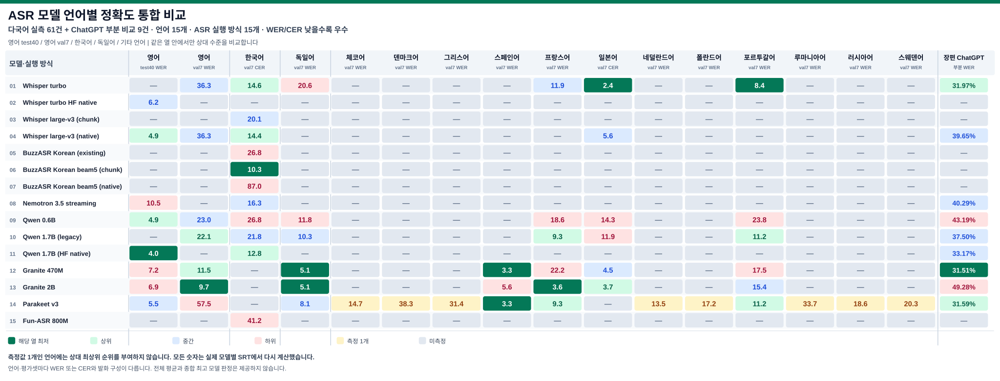

# LzASR — ASR 정확도·성능 통합 비교 (2026-11-07)

> **판정: 영어 FLEURS test 부분표본 40개 발화에서 8개 모델 실제 GPU 인식 PASS. 전체 공식 테스트셋의 승자 확정은 미완료입니다.** 번역이나 자막 타임스탬프 품질이 아니라 **원문 음성 인식 텍스트의 정확도**를 측정했습니다.

## 전체 언어·모델 통합 실측표 (61건)

공식 FLEURS 기준 SRT와 이미 생성한 모델별 SRT를 재채점했습니다. 언어는 영어 → 한국어 → 독일어 → 기타 언어 순서입니다. 영어 test40은 독립 40발화, 나머지 val7은 연결한 7발화입니다. **서로 다른 언어 또는 WER/CER를 평균하지 마십시오.**

기호 — 는 실제 결과가 없는 미측정을 뜻하며 **지원 불가능 또는 100% 오류가 아닙니다.** 30개 언어의 기준 샘플 중 실제 모델 인식 출력을 가진 언어는 15개입니다.

| ASR 모델·실행 방식 | 영어 (test40 WER) ↓ | 영어 (val7 WER) ↓ | 한국어 (val7 CER) ↓ | 독일어 (val7 WER) ↓ | 체코어 (val7 WER) ↓ | 덴마크어 (val7 WER) ↓ | 그리스어 (val7 WER) ↓ | 스페인어 (val7 WER) ↓ | 프랑스어 (val7 WER) ↓ | 일본어 (val7 CER) ↓ | 네덜란드어 (val7 WER) ↓ | 폴란드어 (val7 WER) ↓ | 포르투갈어 (val7 WER) ↓ | 루마니아어 (val7 WER) ↓ | 러시아어 (val7 WER) ↓ | 스웨덴어 (val7 WER) ↓ | 장편 ChatGPT(부분 WER) ↓ |
| :--- | :---: | :---: | :---: | :---: | :---: | :---: | :---: | :---: | :---: | :---: | :---: | :---: | :---: | :---: | :---: | :---: | :---: |
| Whisper turbo | — | 36.28% | 14.64% | 20.59% | — | — | — | — | 11.86% | **2.39%** | — | — | **8.39%** | — | — | — | 31.97% |
| Whisper turbo HF native | 6.24% | — | — | — | — | — | — | — | — | — | — | — | — | — | — | — | — |
| Whisper large-v3 (chunk) | — | — | 20.08% | — | — | — | — | — | — | — | — | — | — | — | — | — | — |
| Whisper large-v3 (native) | 4.91% | 36.28% | 14.44% | — | — | — | — | — | — | 5.57% | — | — | — | — | — | — | 39.65% |
| BuzzASR Korean (existing) | — | — | 26.78% | — | — | — | — | — | — | — | — | — | — | — | — | — | — |
| BuzzASR Korean beam5 (chunk) | — | — | **10.25%** | — | — | — | — | — | — | — | — | — | — | — | — | — | — |
| BuzzASR Korean beam5 (native) | — | — | 87.03% | — | — | — | — | — | — | — | — | — | — | — | — | — | — |
| Nemotron 3.5 streaming | 10.48% | — | 16.32% | — | — | — | — | — | — | — | — | — | — | — | — | — | 40.29% |
| Qwen 0.6B | 4.91% | 23.01% | 26.78% | 11.76% | — | — | — | — | 18.56% | 14.32% | — | — | 23.78% | — | — | — | 43.19% |
| Qwen 1.7B (legacy) | — | 22.12% | 21.76% | 10.29% | — | — | — | — | 9.28% | 11.94% | — | — | 11.19% | — | — | — | 37.50% |
| Qwen 1.7B (HF native) | **4.01%** | — | 12.76% | — | — | — | — | — | — | — | — | — | — | — | — | — | 33.17% |
| Granite 470M | 7.25% | 11.50% | — | **5.15%** | — | — | — | **3.33%** | 22.16% | 4.51% | — | — | 17.48% | — | — | — | 31.51% |
| Granite 2B | 6.91% | **9.73%** | — | **5.15%** | — | — | — | 5.56% | **3.61%** | 3.71% | — | — | 15.38% | — | — | — | 49.28% |
| Parakeet v3 | 5.46% | 57.52% | — | 8.09% | 14.66% | 38.26% | 31.40% | **3.33%** | 9.28% | — | 13.51% | 17.24% | 11.19% | 33.70% | 18.64% | 20.27% | 31.59% |
| Fun-ASR 800M | — | — | 41.21% | — | — | — | — | — | — | — | — | — | — | — | — | — | — |

**실측 61건 · 모델 실행 방식 15종 · 실측 언어 15종 · 기준 샘플만 있는 미측정 언어 15종.**

---

### 장편 ChatGPT reference — 부분 전사·상대 WER (PARTIAL)

- **참조 기준:** ChatGPT Windows 앱의 실제 **음성 입력(받아쓰기)** 기능에 영상에서 추출한 음성을 전달하여 반환받은 텍스트만 사용했습니다. FFmpeg의 오디오 추출·형식 변환만 이용했고, Whisper·Qwen 등 **어떤 로컬 ASR 모델도 ChatGPT reference 제작에 사용하지 않았습니다.**
- **완료 범위:** 전체 오디오 약 02:37:54 중 **00:00:00~00:37:45**, ChatGPT 전사 5개 구간, 영어 NFKC 정규화 후 **2,656단어**. 실제 참고 텍스트는 공개 저장소가 아닌 로컬 비공개 테스트 디렉터리에 보존했습니다.
- **미완료 범위:** **00:37:45~02:37:54**. 이후 ChatGPT 음성 입력이 빈 결과를 반복 반환했고, 이전에 성공했던 26초 양성 대조 입력도 빈 결과를 반환하여 추가 전사를 정답으로 간주할 수 없습니다. 서비스 측 정확한 원인은 확인되지 않았습니다. 미완성 구간을 로컬 모델의 전사로 대체하지 않았습니다.
- **오디오·타임스탬프 한계:** 기존 MP3는 영상에서 추출한 **전체 오디오 트랙**이며 음악과 효과음이 섞여 있습니다. 별도 보컬·대사 분리는 완료되지 않았습니다. 5개 SRT cue는 입력 조각의 시간 경계일 뿐, 자막 한 문장별 정밀 타임스탬프 검증이 아닙니다.
- **측정 방식:** 동일한 5개 시간 창에서 로컬 모델 SRT cue의 중앙 시점으로 대응시키고, NFKC·대소문자 통일·문장부호 및 기호 제외 후 각 구간의 단어 레벤슈타인 편집거리를 합산했습니다. 분모는 ChatGPT 부분 전사의 2,656단어입니다. WER는 **ChatGPT 부분 전사에 대한 상대 오류율**로, 전체 길이의 WER나 절대 정답률을 뜻하지 않습니다.

| 로컬 모델 (기존 출력) | ChatGPT reference 부분 WER ↓ | 편집 오류 / 2,656단어 |
|---|---:|---:|
| Granite Speech 5.0 470M TurboCTC | **31.51%** | 837 |
| Parakeet TDT 0.6B v3 | 31.59% | 839 |
| Whisper large-v3-turbo 기존 실행기 | 31.97% | 849 |
| Qwen3-ASR 1.7B HF 네이티브 | 33.17% | 881 |
| Qwen3-ASR 1.7B 기존 실행기 | 37.50% | 996 |
| Whisper large-v3 네이티브 | 39.65% | 1,053 |
| Nemotron 3.5 Streaming 0.6B | 40.29% | 1,070 |
| Qwen3-ASR 0.6B | 43.19% | 1,147 |
| Granite Speech 5.0 2B | 49.28% | 1,309 |

**판정:** 장편 전체에 대한 ChatGPT reference 생성과 WER 비교는 **FAIL/PARTIAL**입니다. 로컬 Qwen으로 만든 기존 자동 기준은 ChatGPT reference가 아니므로 현재 점수에서 제외했습니다. 과거 지표와 기준은 Git 이력으로 복원할 수 있으며 새 표의 수치와 비교하지 마십시오. 원음의 사람이 확인한 정답 전사가 아니므로 ChatGPT 부분 전사에도 누락이나 오인식이 있을 수 있습니다.

### 전체 02:37:54 영상 평가 게이트 — ChatGPT 기준 100, 최종 모델 미선정

**전체 ChatGPT Reference가 100% 완성되어야** 아래 후보 전체의 실제 전역 WER와 상대 일치점수를 산출할 수 있습니다. **ChatGPT=100**은 절대 정답률이 아니라 비교 기준점이며, 각 로컬 모델의 점수는 **100−전체 WER(%)**입니다. 현재 전체 전사 기준 N이 존재하지 않으므로 **전체 WER·상대 점수는 전 모델 미산출**이며 최적 모델은 선정되지 않았습니다.

아래의 첫/마지막 cue는 기존 모델별 SRT에서 실제로 관측한 첫/마지막 자막 시각입니다. 이것만으로 초반·후반에 **실제 발화가 있었다거나 누락됐다고 단정할 수는 없습니다.** 특히 일부 자동 청크 SRT는 입력 창 경계를 cue 시각으로 사용하므로 자막의 정밀 시간 정렬까지 입증하지 않습니다.

| 로컬 ASR 후보 | 첫 cue | 마지막 cue | 전체 WER / 상대점수 |
|---|---:|---:|---|
| Qwen3-ASR 1.7B HF native | 00:00:00 | 02:37:54 | — / — |
| Whisper large-v3 native | 00:00:00 | 02:37:54 | — / — |
| Granite Speech 5.0 2B | 00:00:00 | 02:37:54 | — / — |
| Whisper large-v3-turbo 기존 실행기 | 00:02:03 | 02:37:01 | — / — |
| Granite Speech 5.0 470M TurboCTC | 00:01:30 | 02:30:00 | — / — |
| Parakeet TDT 0.6B v3 | 00:01:30 | 02:29:30 | — / — |
| Qwen3-ASR 1.7B 기존 실행기 | 00:01:30 | 02:29:22 | — / — |
| Qwen3-ASR 0.6B | 00:02:00 | 02:29:33 | — / — |
| Nemotron 3.5 Streaming 0.6B | 00:02:00 | 02:28:30 | — / — |

전체 평가 PASS 조건은 **(1) ChatGPT 자체 마이크 전사로 전체 9,474초와 중첩 구간 검증, (2) 각 로컬 모델의 전체 입력 커버리지·무음·음성 누락 확인, (3) 동일 정규화·전역 단어 편집거리 및 N/S/D/I 검증, (4) 구간별 누락·반복·시간 정렬 검증**입니다. 기존 이름이 automatic-reference-qwen3-asr-1.7b-hf.srt인 파일은 **Qwen 후보 출력**으로만 평가하며 ChatGPT reference를 대체할 수 없습니다.

## 1. 영어 (WER) — ASR 통합 비교

**영어 정답 897단어 / FLEURS test 40개 독립 발화 / 총 424.02초.** 표와 차트의 언어 표기는 **영어 → 한국어 → 독일어** 순서입니다. 영어·독일어는 WER(단어 오류율), 한국어는 CER(문자 오류율)를 사용하며 모두 **낮을수록 좋습니다**. 서로 다른 언어와 오류 단위를 평균하지 않습니다.

| 순위* | 실제 측정한 영어 모델 및 디코더 | 오류 단어 | 영어 WER ↓ | 총 처리시간** | RTFx** |
|---:|---|---:|---:|---:|---:|
| 1 | **Qwen3-ASR 1.7B, HF 네이티브** | **36 / 897** | **4.01%** | 20.92초 | 20.27× |
| 2= | Qwen3-ASR 0.6B, 원본 런타임 | 44 / 897 | 4.91% | 22.53초 | 18.82× |
| 2= | Whisper large-v3, HF 네이티브 beam=5 | 44 / 897 | 4.91% | 39.50초 | 10.73× |
| 4 | Parakeet TDT 0.6B v3 | 49 / 897 | 5.46% | 8.91초 | 47.59× |
| 5 | Whisper large-v3-turbo, HF 네이티브 beam=5 | 56 / 897 | 6.24% | 12.16초 | 34.87× |
| 6 | Granite Speech 5.0 2B | 62 / 897 | 6.91% | 54.75초 | 7.74× |
| 7 | Granite Speech 5.0 470M TurboCTC | 65 / 897 | 7.25% | **6.26초** | **67.73×** |
| 8 | Nemotron 3.5 Streaming 0.6B | 94 / 897 | 10.48% | 13.30초 | 31.88× |

*순위는 **이번 40발화 부분표본에서 관측한 WER 정렬**입니다. 공식 전체 시험 순위가 아니며 동일 오류율은 공동 순위입니다.

**처리시간·RTFx 해석:** 모델 로딩 시간을 포함한 **단발 wall-clock 측정**입니다. 모두 동일한 GPU에서 실행했지만 엔진·배치 크기·beam·정밀도 설정은 다르므로 **통제된 모델 속도 비교는 아닙니다**. RTFx = 424.02초 ÷ 관측 총시간으로 계산했습니다. 특히 Whisper turbo의 영어 결과는 공식 Hugging Face 네이티브 가중치/실행기로 측정했으며, 별도 Windows 실행 패키지의 결과를 그대로 대표하지 않습니다.

### 1.1. 통계적 불확실성

- 영어 정답 **40개 발화, 897단어**에 대해 단어 단위 Levenshtein 대체·누락·삽입 수를 **발화별로** 계산하고 오류수를 모두 합산했습니다.
- 재현 가능한 난수 시드 20261107로 **발화 40개를 복원추출하는 대응표본 bootstrap 5,000회**를 수행했습니다.
- Qwen3-ASR 1.7B의 WER 관측치 **4.01%**, bootstrap 95% 구간은 **2.33~5.90%**였습니다.
- Whisper large-v3의 WER 관측치 **4.91%**, bootstrap 95% 구간은 **3.03~6.91%**였습니다.
- 두 모델의 오류율 차이(Whisper large-v3 − Qwen 1.7B)는 **+0.89%p**, 대응 bootstrap 95% 구간은 **−0.43~+2.24%p**입니다. **0을 포함하므로 Qwen의 전체 영어 품질 우위를 통계적으로 확정하지 않습니다.**
- 데이터셋의 다른 음성 도메인, 억양, 원음의 잡음 수준, 실제 장편 영상, 반복 GPU 속도는 추가 검증이 필요합니다.

## 2. 한국어 (CER)

**FLEURS ko_kr validation 7개 발화를 연결한 115.48초 별도 표본**입니다. 영어 test의 정규화·표본 수와 다르므로 순위를 합산하지 않습니다.

| 한국어 모델·실행 방식 | CER ↓ | 검증 |
|---|---:|---|
| BuzzASR Korean, beam=5, 청크 | **10.25%** | PASS, 한국어 이번 표본 최저 |
| Qwen3-ASR 1.7B, HF 네이티브 | 12.76% | PASS |
| Whisper large-v3, HF 네이티브 | 14.44% | PASS |
| Whisper large-v3-turbo, 기존 실행기 | 14.64% | PASS, 영어의 HF 네이티브 실행과 구분 |
| Nemotron 3.5 Streaming 0.6B | 16.32% | PASS |
| Qwen3-ASR 1.7B, 기존 실행기 | 21.76% | PASS, 실행 방식 차이 |
| Qwen3-ASR 0.6B | 26.78% | PASS |

BuzzASR의 영어 test 40발화는 **미측정**입니다. Granite Speech 5.0과 Parakeet TDT v3는 이 작업의 한국어 검증 대상으로 사용하지 않았습니다. 한국어 이전 결과의 장문 디코딩 이상 사례는 정상 모델 성능으로 환산하지 않았습니다.

## 3. 독일어 (WER)

**FLEURS de_de validation의 7개 연결 발화**를 사용한 별도 독일어 전사 시험입니다. **영어 test 40개 독립 발화** 및 **한국어 validation 7개 연결 발화**와 표본 구성과 디코딩 조건이 달라 오류율을 합산하거나 국가·언어별 성능을 직접 비교해서는 안 됩니다.

| 독일어 모델 및 실행 방식 | 독일어 WER ↓ | 검증 |
|---|---:|---|
| Granite Speech 5.0 2B | **5.15%** | PASS |
| Granite Speech 5.0 470M TurboCTC | **5.15%** | PASS |
| Parakeet TDT 0.6B v3 | 8.09% | PASS |
| Qwen3-ASR 1.7B 기존 실행기 | 10.29% | PASS, HF 네이티브와 구분 |
| Qwen3-ASR 0.6B 기존 실행기 | 11.76% | PASS |
| Whisper large-v3-turbo 기존 실행기 | 20.59% | PASS, 영어 HF 네이티브와 구분 |

다른 실행 방식에서 독일어 WER를 측정하지 않은 모델은 **미측정**으로 표기합니다. 영어·한국어·독일어의 모델별 결과가 일부 비어 있더라도 누락을 임의로 보간하지 않습니다.

## 4. 공식 데이터 및 재현성

| 항목 | 확인 내용 |
|---|---|
| 공식 데이터셋 | [Google FLEURS](https://huggingface.co/datasets/google/fleurs), CC BY 4.0 |
| 테스트 분할 | en_us test, 전체 647 TSV 행 중 무작위 결정적 선택 40개 |
| 선택 조건 | 서로 다른 전사문 40개, 남성 20개·여성 20개, 시드 20261107 |
| 공식 데이터 리비전 | 70bb2e84b976b7e960aa89f1c648e09c59f894dd |
| 원본 영어 test 오디오 SHA-256 | d9c2e37b41aacd41bc283554a0a82b5476b36887049774ecb2819dcaaa55a356 |
| 원본 영어 test.tsv SHA-256 | 74c046239374deeb60fa63f258f907388093a32bcaa3140965f70ef05c79f7ca |
| 테스트 입력 WAV SHA-256 | b93b181f02a64fb0ff9e977a2e5ca69870631b5be7d055106239ba8746f36734 |
| 공식 정답 기준 SRT SHA-256 | b0254b23c8c6581755922293ab8c0c0c86b53c50b3a6277f1aad14d17e80894c |
| 음성 형식 | 16kHz·모노 WAV, 원본 40발화를 0.5초 무음으로 연결 |
| 인식 방법 | 정답 발화 경계에 맞춰 40개 구간을 각 모델에 **독립적으로** 입력 |
| 평가 지표 | 텍스트 WER, 발화별 편집거리 합 ÷ 정답 단어 수 |
| 결과 저장 형식 | WAV는 공식 평가 입력, 모델 결과와 정답은 SRT만 저장 |
| 중요 제한 | 결과 SRT 시각은 기준 발화 구간을 복사했으므로 **시간 정렬 평가 자료가 아님** |

**선택된 test.tsv 0기준 행 번호 (재현용):**

~~~text
7,12,28,40,63,83,98,109,175,209,210,240,247,257,261,284,286,305,354,365,394,402,433,438,439,444,499,503,510,513,515,545,556,564,576,577,601,624,629,646
~~~

전체 647개 메타데이터 행 중 2개 행은 필드 수가 비정상적이어서 선택 후보에서 제외했습니다. 선정된 40개 원문과 녹음은 공식 배포 아카이브와 대조했고, 기존 평가 SRT·미디어는 덮어쓰지 않았습니다. 공식 출처에서 원문 파일을 다시 받으려면 같은 데이터 리비전과 선택 행 번호를 사용해야 합니다.

### 4.1. 추론 조건

| 모델 계열 | 실제 영어 실행 조건 |
|---|---|
| Qwen3-ASR 1.7B HF | BF16 GPU, English 언어 강제, greedy, 4발화 배치 |
| Qwen3-ASR 0.6B | 기존 공식 런타임, BF16 GPU, English 언어 강제, 최대 4발화 배치 |
| Whisper large-v3 | FP16 GPU, Transformers, English, transcribe, beam=5 |
| Whisper large-v3-turbo | FP16 GPU, 공식 HF 네이티브 가중치, English, transcribe, beam=5 |
| Granite Speech 5.0 2B | BF16 GPU, English 전사 프롬프트, greedy |
| Granite Speech 470M TurboCTC | CUDA, 공식 CTC 생성 |
| Parakeet TDT 0.6B v3 | CUDA, 공식 TDT 생성 |
| Nemotron 3.5 Streaming 0.6B | CUDA RNNT, en-US 프롬프트 |

공식 모델은 [Qwen3-ASR](https://huggingface.co/Qwen/Qwen3-ASR-1.7B-hf), [Whisper large-v3](https://huggingface.co/openai/whisper-large-v3), [Whisper turbo](https://huggingface.co/openai/whisper-large-v3-turbo), [Parakeet TDT v3](https://huggingface.co/nvidia/parakeet-tdt-0.6b-v3), [Granite Speech 5.0](https://huggingface.co/ibm-granite/granite-speech-5.0-2b), [Nemotron 3.5](https://huggingface.co/nvidia/nemotron-3.5-asr-streaming-0.6b) 공식 모델 카드를 참조했습니다.

### 4.2. 로컬 재채점

~~~bat
python -B mod/asr/compare_asr.py --locale en_us
python -B mod/asr/compare_asr.py --locale ko_kr
python -B mod/asr/compare_asr.py --locale de_de
~~~

같은 소스 파일과 SRT가 로컬의 test/en_us, test/ko_kr, test/de_de에 존재하면 재채점할 수 있습니다. 테스트 미디어와 가중치는 **개인 파일 및 외부 배포 자료이므로 공개 Git 저장소에 포함하지 않습니다.** 원본 및 결과 미디어를 업로드하지 않았습니다.

## 5. 평가 용어집

| 용어 | 정식 의미 | 주의 |
|---|---|---|
| ASR | Automatic Speech Recognition, 자동 음성 인식 | 음성에서 단어·문장 인식 |
| STT | Speech-to-Text | ASR 결과의 문자화 기능 |
| WER | Word Error Rate | **(S+D+I)/N**, 단어 단위, 영어 주지표 |
| CER | Character Error Rate | **(S+D+I)/N**, 문자 단위, 한국어 보조지표 |
| S, D, I, N | Substitution(대체), Deletion(누락), Insertion(삽입), 정답 단위 수 | 삽입이 많으면 오류율 100% 초과 가능 |
| Levenshtein distance | 최소 편집거리 | 발화별 오류를 합산 |
| Normalization | Unicode NFKC, 소문자화, 문장부호/기호 제거, 공백 정규화 | 숫자 발음 표준화·고유명사 치환은 미적용 |
| Ground truth | 검증 기준 전사문 | 모델 생성문과 구분 |
| FLEURS | 다국어 음성 평가 데이터셋 | train/dev/test 분할을 혼동하지 않음 |
| Bootstrap 95% CI | 관측 발화를 재추출해 계산한 오류율 불확실성 구간 | 작은 표본, 선택 편향을 완전히 제거하지 못함 |
| RTF | Real-Time Factor = 처리시간/음성 길이 | 낮을수록 빠름 |
| RTFx | 음성 길이/처리시간 = 1/RTF | 높을수록 빠름 |
| Beam search | 여러 텍스트 경로를 평가하는 디코딩 | beam 설정은 속도·정확도 영향 |
| VAD / Chunking | 음성 구간 감지 / 긴 음성 분할 | 입력 분할이 결과에 영향 |
| Forced alignment | 주어진 텍스트를 음성 시간축에 정렬 | 전사 자체가 정확하다는 의미 아님 |
| SRT cue | 자막 번호·시작/종료 시각·텍스트 단위 | 텍스트 WER와 시간 품질을 따로 측정 |
| FP16 / BF16 | GPU 추론 수치 정밀도 | VRAM과 연산의 차이 |
| WER/CER 비교 한계 | 같은 언어·같은 정규화·같은 데이터셋에서 평가 | 서로 다른 단위와 언어는 직접 평균 불가 |

공식 지표 설명: [Hugging Face — Evaluation metrics for ASR](https://huggingface.co/learn/audio-course/en/chapter5/evaluation). 일반적으로 영어처럼 단어 경계가 명확한 언어는 WER를 사용하고, 문자 기준 평가가 더 유효한 언어는 CER를 사용합니다.

## 6. 미완료 검증

- **영어 647개 공식 test 전체 발화 평가 및 다른 데이터셋 교차 검증:** 미완료
- 동일 엔진/배치·디코딩·로딩 조건으로 통제한 순수 추론속도 비교: 미완료
- 장편 실제 영상의 발화 분할·SRT cue 시간 정렬 정확도: 미완료
- 영어/한국어 별도 도메인에 대한 반복실험 및 충분한 표본의 통계적 확증: 미완료

결론은 **“이번 영어 40발화에서 Qwen3-ASR 1.7B가 관측 최저 WER”**이며, 전역적으로 단정할 수 있는 최종 승자라는 표현은 사용하지 않습니다.
